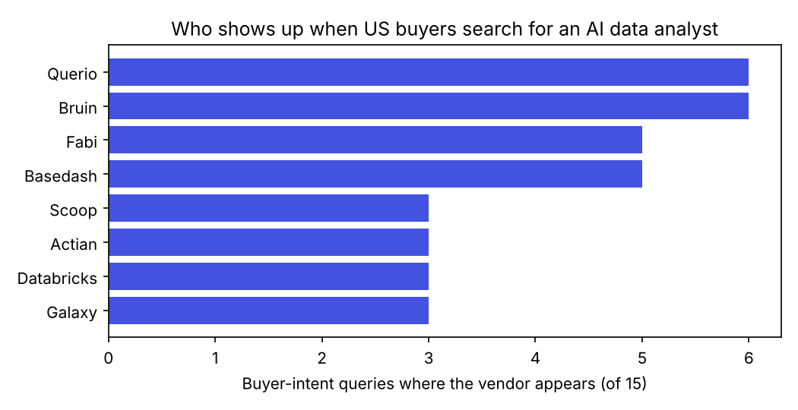

# US GTM Playbook for an AI Data Analyst: Search Audit, ICP Scorecard and 30-Day Plan

How should a small AI company selling an "AI data analyst for business teams" (plain-English questions over SQL data, the category Genloop is in) build organic go-to-market in the US? This repo has the evidence and the plan.

- **`PLAYBOOK.md`**: the plan itself: where the product stands in search, the ideal customer profile, personas, the organic engine (founder LinkedIn, AEO pages, communities, events), the outreach test, the insight loop and a 30-day schedule.
- **Search-visibility audit**: 16 buyer searches recorded on 14 Nov 2026 and scored by `analyze_audit.py`.
- **ICP scorecard**: 5 US segments scored on 5 weighted criteria by `score_icp.py`, with a sensitivity check.
- **Templates**: a pipeline tracker and call-notes sheet for the insight loop.



## Key findings

| Area | Finding |
|---|---|
| Visibility | Genloop appeared in **0 of 15** non-brand buyer searches; even its brand search did not return genloop.ai itself |
| Who wins | Four content-led startups (Querio, Bruin, Fabi, Basedash) appeared in **9 of 15**; Querio and Bruin in **6** each, mostly through "best tools", "alternatives" and use-case pages |
| The gap | On differentiator searches (self-hosted, air-gapped, self-learning) those players appeared in only **1 of 3**, and a competitor owns "self-learning AI data analyst" through press releases |
| ICP | Mid-market B2B SaaS RevOps and mid-market financial services tie at **4.0 of 5**; the tie breaks on how much buyers value self-hosting (SaaS leads at a 10% weight, finance at 30%) |
| Plan | Test both segments for 2 weeks with 50 accounts each; pick the one with more meetings per 100 accounts (minimum 5 meetings) |

## Method and limits
- The audit is a **snapshot from one search engine on one day**, not a ranking study. Domains were recorded as returned; vendor domains are mapped in `analyze_audit.py`. Rechecking the same 15 searches every 2 weeks turns it into a tracking metric.
- ICP scores and weights are **hypotheses** written with reasons in `data/icp_segments.csv`. They are there to be tested by outreach, not believed.
- Company facts come from public sources only: YourStory (Nov 2025: self-learning AI data analysts for sales and operations teams, self-hosted option, ~$300K pre-seed, 7 B2B clients, competitors ThoughtSpot, Wisdom and Omni) and Genloop's March 2026 press release ("Data Analyst for Every Team", a claimed Spider2 score of 97). I have no internal data.

## Run
```bash
pip install matplotlib
python analyze_audit.py   # share of voice from the search audit
python score_icp.py       # ICP ranking and sensitivity
```
